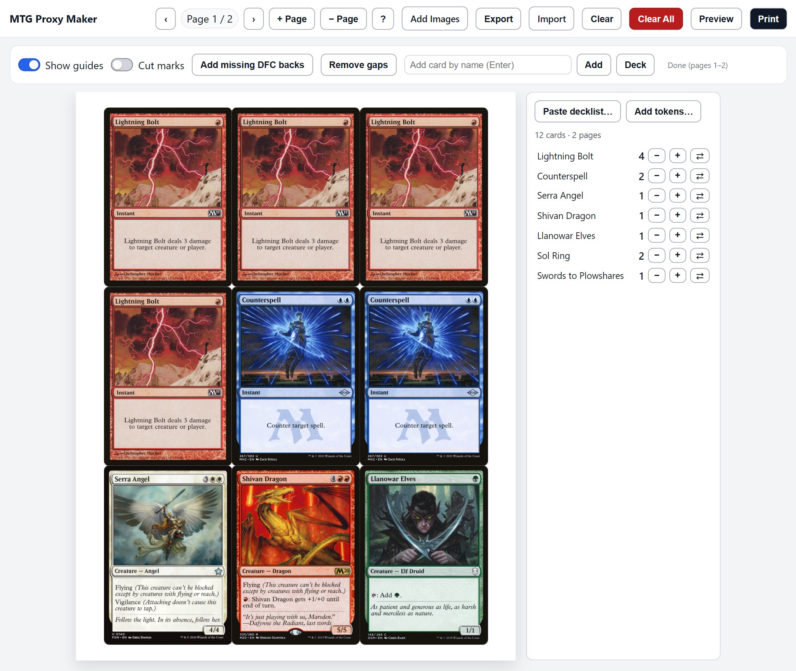
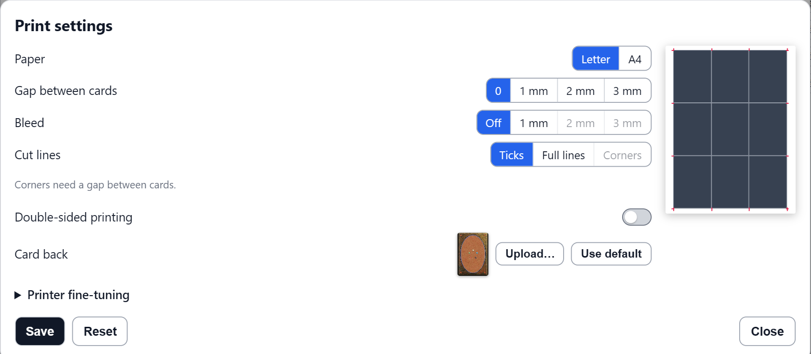

# MTG Proxy Maker

Print Magic: The Gathering proxy cards from your browser. Paste a decklist, and the app pulls each card's image from [Scryfall](https://scryfall.com) and lays the cards out at real card size, nine to a sheet, ready to print and cut.

**Try it:** [cmullis1.github.io/MTG-Proxy-Maker](https://cmullis1.github.io/MTG-Proxy-Maker/) (nothing to install).

## What it does

- **Decklists in, printable sheets out.** Paste a list like `4 Lightning Bolt`, or an Arena or Moxfield export with set codes for exact printings. The cards fill as many pages as they need.
- **Real card size.** Cards print at 2.475" x 3.465" by default (99% of a standard 2.5" x 3.5" card, and adjustable), on Letter or A4 paper. Print preview shows every page as it will come out.
- **Deck panel.** One row per card with its count: add or remove copies, pick a different printing's art for each copy, and add the tokens and emblems your cards make.
- **Print options.** Gaps between cards, bleed (a border of the card's own colour so slightly-off cuts don't show white), three styles of cut lines, and printer fine-tuning for printers that don't print exactly where they should. Choices that would put cards too close to the paper's edge are greyed out.
- **Double-sided printing.** A card back (the default one or your own) behind each card, lined up for a long-edge flip. Double-faced cards can print their back face on the reverse instead.
- **Save and share.** Save a layout as a `.mtgproxy` file (with or without the images inside), or export a print-ready PDF.
- **Works offline.** It installs as an app in Chrome and Edge, and cards you have fetched before keep working without a connection.
- **Light and dark themes.**

## How to run it

Use the [live version](https://cmullis1.github.io/MTG-Proxy-Maker/), or run it yourself:

1. Download this repository.
2. Open `MTG Proxy Maker.html` in any modern browser (Chrome, Edge, Firefox, Safari). Keep `card-back.jpg` and the `vendor/` folder next to it.
3. Search for a card by name, or click **Deck** and then **Paste decklist...**.
4. Arrange the cards, then click **Print** (or press `P`). In the print dialog, print at 100% (Actual size), not "Fit to page".

There is no build step and no server to run. Opened straight from a file, everything works except that the PDF export can't read the default card back: upload your own card back in Print settings, or serve the folder (for example `python -m http.server`) and open it from there.

### Deck panel

Click **Deck** in the toolbar to show a side panel with one row per card and its count.

- **Paste decklist...**: one card per line (for example `4 Lightning Bolt`). Add a set code like `[M11]` or `(M11)`, or paste an Arena or Moxfield export such as `1 Sol Ring (CMR) 472` for that exact printing. Switches skip basic lands and Snow-Covered basics.
- **+ / -**: **+** adds a copy right after the row's last copy; **-** removes the last copy. The cards after it move over to make room or close the gap, as far as the next empty cell.
- **Hover and click**: hovering a row outlines its copies on the page; clicking a name jumps to its first copy. In the panel, the up and down arrows move between rows and Home/End jump to the first or last row.
- **⇄ / Change printing...**: pick the art for each copy of a card, or use one printing for all copies. Right-click a card and choose **Change printing...** to start on that copy. Changes apply when you click **Done**; back faces placed as separate cards switch to the new art too.
- **Add tokens...**: lists the tokens and emblems your cards make, with a quantity for each; press Enter in a quantity field to add.

The panel never prints, and print preview hides it.

### Keyboard shortcuts

| Key | Action |
|-----|--------|
| **Arrow keys** | Move focus between cells |
| **1-9** | Jump to a specific cell |
| **C** | Copy focused cell (internal clipboard) |
| **X** | Cut focused cell (internal clipboard) |
| **V** | Paste into focused cell |
| **D + Drag** | Duplicate card to target cell |
| **Alt + Arrows** | Reorder (swap) focused cell |
| **Delete / Backspace** | Clear focused cell |
| **Ctrl/⌘ + C** | Copy cell image to system clipboard |
| **Ctrl/⌘ + V** | Paste image from system clipboard |
| **Ctrl/⌘ + Delete** | Clear current page |
| **Ctrl/⌘ + Shift + Delete** | Clear all pages |
| **Shift + Delete** | Remove current page |
| **N** | Add a new page |
| **[ / ]** | Previous / next page |
| **Ctrl/⌘ + ← / →** | Previous / next page |
| **Home / End** | First / last page |
| **P** | Print all pages |
| **G** | Toggle guides |
| **M** | Toggle cut marks |
| **? / H / F1** | Open help dialog |
| **Esc** | Cancel cut/copy or close any open dialog |

### Print settings and calibration

Press **?** to open Help, then click **Print settings** to choose:

- **Paper**: Letter or A4
- **Gap between cards**: 0 to 3 mm
- **Bleed**: 0 to 3 mm of border colour around each card, so slightly-off cuts don't show white
- **Cut lines**: Ticks (short marks in the margin), Full lines (for trimmers) or Corners (needs a gap)
- **Double-sided printing**: a back page after each page (see below)
- **Card back**: the default image, or **Upload...** your own; **Use default** goes back to the default

Paper, gap and bleed choices that would put the cards within 4 mm of the edge (where most printers can't print) are greyed out; hover over one to see why.

Nothing changes until you click **Save**; **Close** or Esc discards your changes. **Reset** returns gap, bleed, cut lines, printer offsets, card size and back offsets to their defaults. Cut lines print only when the **Cut marks** switch is on (or press **M**).

If prints come out clipped or misaligned, open **Printer fine-tuning** in the same dialog:

1. Adjust the vertical or horizontal offset (the cards are centred on the page; offsets move them), or the card size.
2. Leave **Keep 2.5x3.5 ratio** on to keep the card's shape.
3. Choose **Cover** (fills the cell, may crop edges) or **Contain** (fits inside, may leave margins).
4. With double-sided printing, use **Back offset X / Y** to line the backs up with the fronts.

### Double-sided printing

1. Turn on **Double-sided printing** in Print settings and click **Save**.
2. Print with the app's **Print** button (or `P`), not Ctrl+P: it waits for back images that are still loading, which Ctrl+P can't.
3. In the print dialog, choose two-sided printing and flip on the **long edge**.
4. If the backs sit off the fronts, adjust **Back offset X / Y** under Printer fine-tuning.

**Double-faced cards:** when you turn double-sided printing on with double-faced cards in the layout, the app asks whether to print their back faces on the reverse instead of the card back. If you say yes and the back faces are also placed as separate cards, it offers to remove those so they don't print twice.

### Export and import

- **Export (Full)**: saves the layout and every card image in a `.mtgproxy` file. Larger, and works fully offline.
- **Export (Lightweight)**: saves the layout and Scryfall links only. Small, and the images are fetched again on import.
- **Export as PDF (ready to print)**: a PDF at the exact page size, with back pages when double-sided printing is on. Choose **High-quality JPEG** (smaller file) or **Original PNG** (exact pixels, larger file). Print it at **Actual size / 100%**, not "Fit to page".
- **Import**: open a `.mtgproxy` file to restore a saved layout. If its print settings differ from yours, you're asked whether to **Keep mine** or **Use the file's**.

### Browser support

Works in all modern browsers. A few features depend on the browser:

- **System clipboard** (Ctrl+C/V for images) needs the browser's image Clipboard API. Where it is blocked, use **Add Images** or drag image files onto the page.
- **Installing as an app** works in Chromium-based browsers (Chrome, Edge).
- **Image storage** uses IndexedDB and falls back to memory in private browsing.

Card data and images come from the [Scryfall API](https://scryfall.com/docs/api). Searching for new cards needs an internet connection; cards you have fetched before are cached. The app keeps to Scryfall's published rate limits.

## How it was built

I directed this project and Claude Code (Anthropic's AI coding tool) wrote most of the code. My part was the problem (printing playtest proxies that come out the right size and line up on both sides of the page), the decisions about how each feature should behave, and the testing.

- It is one HTML file (about 7,700 lines of HTML, CSS and JavaScript) with no framework and no build step. The only library is [jsPDF](https://github.com/parallax/jsPDF), kept in `vendor/` with its license and checksum, for the PDF export.
- The recent features (the print pipeline, gap-free placement, the Deck panel and the centred grid) each went through a written design and plan before any code was written.
- 791 automated checks across 25 in-browser test files cover decklist parsing, page layout, placement, the Deck panel, tokens, double-sided printing, PDF export and Scryfall rate limits. A separate print test drives headless Chrome, prints known layouts and compares them pixel by pixel with reference prints, so any unintended change to what prints is caught. The tests live in my working copy and are not part of this repository.

## License

MIT, see [LICENSE](LICENSE). jsPDF is MIT licensed, see [vendor/LICENSE-jspdf.txt](vendor/LICENSE-jspdf.txt).

Card images and data are provided by Scryfall. Magic: The Gathering and its card images are the property of Wizards of the Coast. This project is not affiliated with or endorsed by Wizards of the Coast or Scryfall. Proxies are for personal playtesting and are not for sale.
